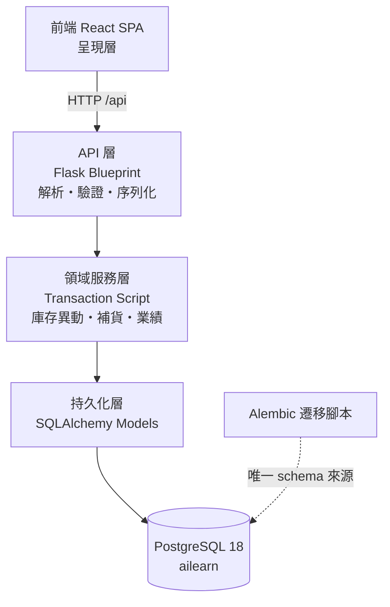
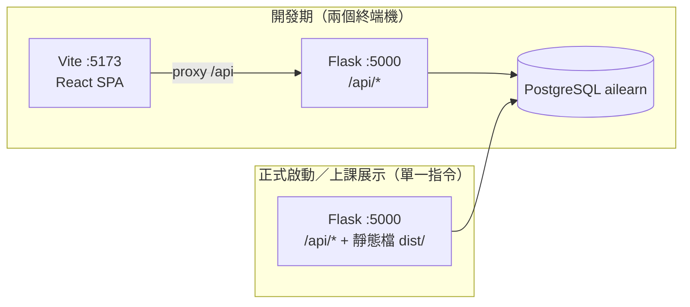

# Architecture Spine — 庫存管理系統

## Design Paradigm

**分層架構（Layered）＋ Transaction Script**：每一層只允許依賴下一層，資料庫只由最底層碰；每個「動作」（建立入庫單、盤點結算、算補貨建議）是一個明確的交易腳本。



依賴方向（規則，非示意）：`FE → API → SVC → REPO → DB`。**反向依賴一律禁止**（SVC 不得 import Flask、REPO 不得 import API 層、API 層不得直接寫 SQL）。

## Invariants & Rules

### AD-1 — 庫存現量的唯一寫入路徑

- **Binds:** `stock.qty`、FR-9、FR-14、NFR-4
- **Prevents:** 兩處各自改庫存數字（UI 一套、報表一套），造成帳實不符且無法追溯。
- **Rule:** `stock.qty` 只能由領域服務層的「套用庫存異動」函式改變；任何 SQL、原生 UPDATE、ORM 直接賦值給 `stock.qty` 都視為違規。讀取庫存現量一律經同一服務層，不得各處自行 JOIN 推算。

### AD-2 — 庫存異動為 append-only

- **Binds:** `stock_movements`、FR-6、FR-15、NFR-6
- **Prevents:** 稽核軌跡被就地修改，事後查不出數字為什麼變成這樣。
- **Rule:** `stock_movements` 只允許 INSERT，禁止 UPDATE 與 DELETE；更正以新增一筆方向相反的異動表達，並以 `correction_of_movement_id` 指向被更正的原始異動，形成可互追的雙向連結。應用層不提供任何異動刪除或修改的端點。

### AD-3 — 數量變動只能來自單據

- **Binds:** FR-4、FR-7、FR-11、FR-14
- **Prevents:** 出現沒有單據、沒有出處的孤兒異動，讓「追溯到單據」這條承諾破功。
- **Rule:** 每筆 `stock_movements` 必須帶 `document_id`；`documents.doc_type` 只能是 `IN`（入庫單）、`OUT`（出庫單）、`STOCKTAKE`（盤點單）。不提供直接建立異動的 API。

### AD-4 — 一張單據等於一個資料庫交易

- **Binds:** FR-4、FR-7、FR-12、NFR-4
- **Prevents:** 多品項單據部分成功（單據寫入了但庫存沒扣），造成單據與異動不一致。
- **Rule:** 送出單據的請求必須在同一個 DB transaction 內完成：建立 `documents` → 建立 `document_items` → 產生 `stock_movements` → 更新 `stock.qty`；任一步失敗則整批 rollback，API 回傳錯誤且不留下半套資料。

### AD-5 — 補貨建議為即時衍生值

- **Binds:** FR-19、FR-20、SM-8、NFR-2
- **Prevents:** 建議數字被快取或落地成另一份資料，與實際庫存脫節、且課堂無法手算重現。
- **Rule:** 補貨建議不得寫入資料表、不得快取。`GET /api/replenishment/suggestions?window=30` 每次都從 `stock_movements` 即時計算（`日均消耗 = 區間內 OUT 數量 ÷ 區間天數`；`建議量 = max(0, safety_qty + 日均消耗 × products.lead_time_days − stock.qty)`），並在回應中標明 `window`、`calculated_at` 與每個品項的 `lead_time_days`。

### AD-6 — 業績以出庫單為計算單位

- **Binds:** FR-24、FR-25、FR-20、A-20
- **Prevents:** 把盤點差異、報廢、內部領用算成某人的銷售，或用異動列數當出貨次數。
- **Rule:** 業績一律以 `documents`（`doc_type='OUT'` 且 `salesperson_id` 非空）為母體，金額 = Σ(`document_items.qty` × `document_items.unit_price`)。`stock_movements` 不得直接作為業績來源；「未歸屬銷售」另以 `salesperson_id IS NULL` 的 OUT 單獨立計。

### AD-7 — 業務規則在領域層驗證

- **Binds:** FR-7、FR-12、FR-1、NFR-4
- **Prevents:** 規則只做在前端，換個 API 呼叫或直接打資料庫就會繞過，導致負庫存、無原因的盤點差異、sku 重複等髒資料。
- **Rule:** 下列規則由領域層強制，前端驗證只是體驗優化：sku 唯一、數量為正整數、出庫不得使 `stock.qty` 為負、盤點差異必填原因、單據送出後不可修改。違反時拋出領域錯誤，API 層轉為統一的錯誤形狀（見 AD-9）。

### AD-8 — 密碼與連線字串不落地

- **Binds:** NFR-2、專案硬性規則（`協作區\AGENTS.md`）
- **Prevents:** 密碼進版控、進 AI 對話紀錄、進產出文件。
- **Rule:** 資料庫連線字串只從環境變數讀取（`DATABASE_URL`）。`alembic.ini` 的 `sqlalchemy.url` 留空並由 `env.py` 以環境變數覆寫；專案只提供 `.env.example`（僅 key 無值）。不得建立 `pgpass.conf`、不得修改 `pg_hba.conf`、不得重啟資料庫服務。

### AD-9 — API 回應與錯誤形狀統一

- **Binds:** 全部 FR、前端所有呼叫
- **Prevents:** 前端每個頁面各自處理錯誤與分頁，導致不一致的提示與顯示。
- **Rule:**
  - 列表端點一律回 `{ "items": [...], "total": n, "page": n, "page_size": n }`。
  - 單筆資源回資源物件本身（200）／建立回 201 與 `Location`。
  - 錯誤一律回 `{ "error": { "code": "STOCK_INSUFFICIENT", "message": "…", "details": {...} } }`，HTTP 狀態碼：400 驗證、404 不存在、409 狀態衝突（庫存不足、sku 重複、單據已送出）、422 領域規則違反。
  - 時間一律 ISO-8601 含時區（`2026-10-21T13:05:00+08:00`），前端負責轉本地顯示。

### AD-10 — 數量與金額的型別

- **Binds:** FR-17、FR-24、FR-19、AD-9
- **Prevents:** 浮點累加誤差讓「期末 = 期初 + 入庫 − 出庫」在報表上對不上，驗收失敗。
- **Rule:** 數量在資料庫與 API 一律為**整數**（`INTEGER`）；單價與金額在資料庫為 `NUMERIC(10,2)`，API 以**字串**回傳（如 `"1250.00"`），前端格式化時才轉數字。四捨五入只發生在顯示層與明確標示的計算點。

### AD-11 — schema 的唯一來源是遷移腳本

- **Binds:** NFR-2、AD-8、附錄 D
- **Prevents:** 「手冊的 SQL」、「ORM 自動建表」、「線上改 DB」三份定義分歧，重建環境時對不上。
- **Rule:** 所有 schema 變更以 Alembic 遷移腳本交付（`flask db migrate` → 審閱 → `flask db upgrade`）；**禁用** `db.create_all()`、禁用手改資料庫、禁用把 SQL 檔當成 schema 來源。`使用手冊.md` §6 的 SQL 僅作藍圖參考。

### AD-12 — 前端不得持有業務規則的所有權

- **Binds:** 全部 FR、AD-7
- **Prevents:** 兩端各有一份規則（例：負庫存判斷寫在 React 與 Flask 各一份）而行為不一致。
- **Rule:** 前端不做權威驗證、不做金額計算、不快取業務資料；所有業務數字（庫存現量、業績、補貨建議、報表）一律向 API 取得並以 API 回應為準。前端只負責輸入格式檢查與呈現。

### AD-13 — 資料模型與詞彙表一致

- **Binds:** PRD §3 詞彙表、附錄 D
- **Prevents:** 後端叫 `item`、前端叫 `goods`、資料庫叫 `product`，文件與程式各說各話。
- **Rule:** 資料表與欄位採 PRD 詞彙表的英文對應，全專案統一使用：`products`（品項）、`stock`（庫存現量）、`stock_movements`（庫存異動）、`documents`（單據）、`document_items`（單據明細）、`salespersons`（銷貨員）。禁止出現同義詞別名（item/goods/prod）。API 的 JSON 欄位名同樣使用這組名稱（camelCase 僅限前端本地狀態）。

### AD-14 — 認證與 Session 由單一模組負責

- **Binds:** FR-27 ～ FR-31、NFR-10、全部 API 端點
- **Prevents:** 每個端點各自實作「檢查有沒有登入」造成規則分歧（有的檢查、有的沒檢查、有的檢查方式不同）。
- **Rule:** 登入狀態一律由 `app/security.py` 的守門裝飾器處理：`@login_required` 判斷是否登入（未登入 → 401）、`@require_role(...)` 判斷角色（角色不符 → 403）。端點**不得自行**讀 `session` 判斷權限。Session 以 Flask 簽章 cookie 保存，cookie 為 `HttpOnly` + `SameSite=Lax`。

### AD-15 — 密碼只存單向雜湊

- **Binds:** `users.password_hash`、NFR-10
- **Prevents:** 密碼明文外洩（資料庫被匯出、log 被貼上、截圖外流）。
- **Rule:** 密碼只能經 `werkzeug.security.generate_password_hash` 雜湊後存�� `users.password_hash`，驗證一律用 `check_password_hash`。**禁止**在任何欄位、log、錯誤訊息、API 回應或文件中出現明文密碼。登入失敗一律回「帳號或密碼錯誤」，不區分帳號不存在與密碼錯誤。

### AD-16 — 記錄者與歸屬一律取自登入身分

- **Binds:** FR-31、FR-23、FR-14、FR-24
- **Prevents:** 前端可以夾帶「記錄者」或「銷貨員」值，讓稽核軌跡與業績歸屬被偽造。
- **Rule:** 建立單據時的 `recorded_by` 一律由後端寫入 `session` 中的登入帳號，**忽略**前端傳入的同名字段。出庫單的銷貨員歸屬：銷貨員角色固定為自己；管理員可指定他人（後端檢查角色）。業績統計以 `users` 為母體，**不得**再出現「未歸屬」的可信度疑慮。

### AD-17 — 銷貨員與登入帳號是同一個實體

- **Binds:** FR-22、FR-23、FR-24、附錄 D
- **Prevents:** 兩套身分（users 與 salespersons）各自為政，造成「這個店員到底是哪個帳號」的資料不一致。
- **Rule:** 只有 `users` 一張表；`role` 欄位區分 admin／clerk／salesperson／viewer。**不再存在** `salespersons` 表。既有資料以遷移腳本轉為 `role='salesperson'` 的使用者（AD-11：schema 變更只能走遷移腳本）。

## Consistency Conventions

| Concern | Convention |
| --- | --- |
| 命名（後端檔案／函式） | 模組 `snake_case`、類別 `PascalCase`、函式與變數 `snake_case`；Blueprint 以資源命名 `products_bp`、`documents_bp`、`stock_bp`、`reports_bp`、`replenishment_bp`、`salespersons_bp` |
| 命名（API 路由） | 全小寫複數 + 連字號：`/api/stock-movements`、`/api/replenishment/suggestions`、`/api/salespersons`；單一資源用路徑參數 `/api/products/<int:product_id>` |
| 命名（前端） | 頁面元件 `PascalCase.jsx`、API 封裝與 hooks `camelCase.js`／`useXxx.js`；元件檔名對應路由（如 `ProductsPage.jsx`） |
| 命名（資料庫） | 表名複數 `snake_case`、欄位 `snake_case`、外鍵 `<單數表名>_id`、索引 `idx_<表>_<欄位>` |
| 資料格式 | 時間 ISO-8601 含時區；日期 `YYYY-MM-DD`；數量整數；金額字串兩位小數（AD-10）；CSV 匯出一律 UTF-8 with BOM |
| API 回應 | 列表一律 `{items,total,page,page_size}`；錯誤一律 `{error:{code,message,details}}`（AD-9） |
| 分頁 | 預設 `page=1`、`page_size=50`、上限 100；超出回傳 400 |
| 狀態與流程 | 單據送出後不可改（AD-4、AD-7）；需要更正時建立反向單據，不提供編輯／刪除已送出單據的端點 |
| 設定 | 環境變數前綴 `APP_`（如 `APP_SECRET_KEY`、`APP_DB_URL`），設定讀取集中在 `backend/app/config.py`，不得散落在各模組 |
| 資料庫連線 | 單一字串 `DATABASE_URL`（psycopg v3 URL），Alembic 與 Flask 共用同一設定（AD-8、AD-11） |
| 交易 | 寫入操作一律在 `session.begin()` 內；唯讀查詢不得開長交易 |
| 錯誤處理 | 領域層拋 `DomainError(code, message, details)`；API 層統一轉 4xx；未捕捉例外記錄 traceback 並回 500 `INTERNAL_ERROR` |
| 日誌 | 結構化單行格式（時間・層級・事件・關鍵欄位）輸出到 stdout；記錄單據號、對應異動筆數，不記錄密碼與完整連線字串 |
| 測試 | `pytest` 置於 `backend/tests/`；領域層與 API 層皆需測試；資料庫測試使用獨立測試庫或交易回滾；每個核心規則（負庫存阻擋、盤點必填原因、期末重算、補貨建議手算值、業績彙總）至少一個測試 |
| 前端狀態 | 不引入 Redux 等全域狀態庫；伺服器資料以 `fetch` ＋ 自訂 hook（`useApi`）取得，不做跨頁快取（AD-12、A-26） |
| 前端 UI | 元件庫 Ant Design 6；圖表 Recharts 3；路由 react-router-dom 7；表單元件一律用 AntD Form（AD-7 的前端提示由後端錯誤回應統一呈現） |
| 命名一致性 | 中文字段顯示名稱由前端集中於 `src/constants/labels.js`，不在各頁面硬寫（AD-13） |

## Stack

> 版本已於 2026-10-21 實測／實查確認（`uv pip install` 實際安裝結果、`npm view` 實際查詢）。

| Name | Version |
| --- | --- |
| Python | 3.14.7（venv：`.venv`，由 uv 建立） |
| Flask | 3.1.3 |
| Flask-SQLAlchemy | 3.1.1 |
| Flask-Migrate | 4.1.0 |
| Alembic | 1.20.0 |
| SQLAlchemy | 2.1.5 |
| psycopg (v3) | 3.3.6（binary wheel 可用，已於 Python 3.14.7 實測安裝） |
| Flask-Cors | 6.0.5（僅開發期跨埠用） |
| pytest | 9.1.1 |
| Werkzeug（密碼雜湊、session 簽章） | 3.1.9（隨 Flask） |
| uv | 0.13.1（依賴管理與 lock） |
| Node.js | 24.21.0（僅供前端建置與 OpenCode） |
| React / React DOM | 19.3.1 |
| Vite | 8.3.4 |
| @vitejs/plugin-react | 6.1.2 |
| Ant Design | 6.6.7 |
| Recharts | 3.10.1 |
| react-router-dom | 7.18.4 |
| PostgreSQL | 18.6（本機服務 `postgresql-x64-18`，資料庫 `ailearn`） |

## Structural Seed

### 資料模型（核心實體 ERD）

```mermaid
erDiagram
  products ||--|| stock : "1:1 庫存現量"
  products ||--o{ document_items : "被引用於"
  products ||--o{ stock_movements : "被引用於"
  documents ||--|{ document_items : "包含明細"
  documents ||--o{ stock_movements : "產生異動"
  users ||--o{ documents : "歸屬於(可為空)"
  stock_movements ||--o{ stock_movements : "correction_of 反向關聯"

  products {
    int id PK
    varchar sku UK
    varchar name
    varchar category
    varchar unit
    numeric price
    int safety_qty
    int lead_time_days "預設 7，品項層級補貨前置天數"
    bool is_active
    timestamptz created_at
    timestamptz updated_at
  }
  stock {
    int product_id PK_FK
    int qty
    timestamptz updated_at
  }
  stock_movements {
    int id PK
    int product_id FK
    int document_id FK
    varchar move_type "IN|OUT|ADJUST"
    int qty
    numeric balance_after
    int correction_of_movement_id FK
    varchar recorded_by
    text note
    timestamptz created_at
  }
  documents {
    int id PK
    varchar doc_type "IN|OUT|STOCKTAKE"
    varchar doc_no UK
    date doc_date
    int salesperson_id FK "可為空=未歸屬"
    varchar recorded_by
    text note
    timestamptz created_at
  }
  document_items {
    int id PK
    int document_id FK
    int product_id FK
    int qty
    numeric unit_price
    text note
  }
  users {
    int id PK
    varchar username UK
    varchar display_name
    varchar password_hash
    varchar role "admin|clerk|salesperson|viewer"
    bool is_active
    timestamptz created_at
    timestamptz last_login_at
  }
```

索引：`stock_movements(product_id, move_type, created_at)`、`stock_movements(document_id)`、`documents(doc_type, created_at)`、`documents(salesperson_id, created_at)`；`users(username)` unique、`document_items(product_id)`。

### 原始碼樹（seed）

```text
庫存管理系統/
├── backend/
│   ├── app/
│   │   ├── __init__.py        # create_app(): 註冊 blueprint、db、migrate、CORS
│   │   ├── config.py          # 設定讀取（AD-8：只讀環境變數）
│   │   ├── extensions.py      # db = SQLAlchemy(); migrate = Migrate()
│   │   ├── models/            # 持久化層：product, stock, movement, document, salesperson
│   │   ├── domain/            # 領域層：stock_service, replenishment, performance, errors
│   │   ├── api/               # API 層：每個資源一個 blueprint + schema
│   │   └── cli.py             # flask db … 與 seed 指令
│   ├── migrations/            # Alembic（AD-11：schema 唯一來源）
│   ├── tests/                 # pytest：domain 與 api
│   └── pyproject.toml
├── frontend/
│   ├── src/
│   │   ├── api/               # fetch 封裝（useApi、端點常數）
│   │   ├── components/        # 共用元件
│   │   ├── pages/             # 各路由頁面
│   │   ├── constants/labels.js
│   │   └── main.jsx
│   ├── index.html
│   ├── vite.config.js         # dev proxy /api → 127.0.0.1:5000
│   └── package.json
├── docs/                      # 長期知識（PRD、架構、操作手冊）
├── _bmad/                     # BMAD 核心與模組
└── _bmad-output/              # BMAD 產出（PRD、spine、epics、story）
```

### 執行與部署（單機）



- 開發期：終端機 A `uv run flask run --port 5000`；終端機 B `npm run dev`（Vite 5173，`/api` proxy 至 5000）。
- 正式啟動：`npm run build` → `frontend/dist/` → Flask 掛載 `static_folder` 與 SPA fallback，單一網址 `http://127.0.0.1:5000`。
- 備份：`pg_dump` 檔案（手冊 §7），不建自動上雲備份。
- 密碼：啟動時由使用者輸入或以環境變數提供，不落地（AD-8）。

### 主要 API 表面（seed，細節由 story 定義）

| 方法 | 路徑 | 對應需求 |
| --- | --- | --- |
| GET/POST | `/api/products` | FR-1、FR-2 |
| GET/PATCH | `/api/products/<id>` | FR-3 |
| GET | `/api/stock` | FR-9 |
| GET | `/api/stock/low-stock` | FR-10 |
| GET | `/api/stock-movements` | FR-14 |
| GET | `/api/documents?type=IN` | FR-5 |
| POST | `/api/documents/stock-in` | FR-4 |
| POST | `/api/documents/stock-out` | FR-7 |
| POST | `/api/documents/stocktake` | FR-11、FR-12 |
| GET | `/api/reports/stock-summary` | FR-17 |
| GET | `/api/replenishment/suggestions?window=30` | FR-19 |
| GET | `/api/replenishment/statistics` | FR-20 |
| GET/POST | `/api/salespersons` | FR-22 |
| GET | `/api/reports/sales-performance` | FR-24 |
| GET | `/api/reports/sales-performance/<salesperson_id>` | FR-25 |
| GET | `/api/exports/<report>.csv` | FR-16、FR-21、FR-26 |

## Capability → Architecture Map

| Capability / Area | Lives in | Governed by |
| --- | --- | --- |
| 品項主檔（FR-1～3） | `app/api/products_bp.py` → `app/models/product.py` | AD-7、AD-11、AD-13 |
| 入庫（FR-4～6） | `app/api/documents_bp.py` → `app/domain/stock_service.py` | AD-1～AD-4、AD-7 |
| 出庫與銷貨員歸屬（FR-7、8、23） | `app/api/documents_bp.py`、`app/domain/stock_service.py` | AD-1～AD-4、AD-6、AD-7 |
| 庫存查詢與警示（FR-9、10） | `app/api/stock_bp.py` → `app/domain/stock_service.py` | AD-1、AD-12 |
| 盤點（FR-11～13） | `app/api/documents_bp.py` → `app/domain/stocktake.py` | AD-2～AD-4、AD-7 |
| 異動稽核與匯出（FR-14～16） | `app/api/stock_bp.py`、`app/api/exports_bp.py` | AD-2、AD-9、AD-10 |
| 進銷存報表（FR-17、18） | `app/api/reports_bp.py` → `app/domain/reports.py` | AD-1、AD-9、AD-10 |
| 補貨判斷（FR-19～21） | `app/api/replenishment_bp.py` → `app/domain/replenishment.py` | AD-5、AD-9 |
| 銷貨員業績（FR-22、24～26） | `app/api/salespersons_bp.py`、`app/api/reports_bp.py` → `app/domain/performance.py` | AD-6、AD-9、AD-10 |
| 資料庫結構 | `migrations/`（Alembic） | AD-8、AD-11 |
| 前端呈現 | `frontend/src/pages/*` | AD-12、AD-13 |
| 使用者登入與權限（FR-27～31） | `app/api/auth_bp.py`、`app/api/users_bp.py` → `app/domain/auth_service.py` → `app/security.py` | AD-14 ～ AD-17 |
| 設定與連線 | `app/config.py`、`alembic/env.py` | AD-8 |

## Deferred

| 項目 | 為何延後 |
| --- | --- |
| 帳號密碼與角色權限 | v1 為單機環境；業績歸屬自報的風險已由 PRD A-19／SM-C6 聲明 |
| 快取層（Redis 或 memoize） | 單機小資料量，AD-5 已要求即時計算，快取只會帶來一致性風險 |
| 背景工作 / 排程（自動備份、報表排程） | 備份以 `pg_dump` 手動執行即可，符合教學情境 |
| 雲端部署、容器化、CI/CD | 與「本機可交作業」目標衝突（PRD §5） |
| 供應商與採購模組 | 補貨建議只輸出清單（PRD OQ-5） |
| AI 預測（趨勢補貨、自然語言查詢） | PRD §5 非目標；可作課程加值展示項 |
| 跨店／多倉 | 單一營業地點（PRD A-1、OQ-13） |
| 樂觀鎖與併發控制 | v1 單機單人操作；`stock.qty` 更新以交易內的 `SELECT ... FOR UPDATE` 保守處理 |
| 行動裝置原生 App | 網頁介面已滿足 |
| 國際化（多語介面） | 介面固定繁體中文（PRD NFR-5） |
| 密碼重設流程、忘記密碼、SSO、多因素驗證 | v1 只做管理員重設他人密碼（PRD OQ-20）；自助重設需要郵寄或外部服務，超出本機單機範圍 |
| 權限矩陣細化（自訂角色、資源層級權限） | 四種固定角色已足以支撐 v1；自訂角色需要 UI 與資料模型擴充 |
